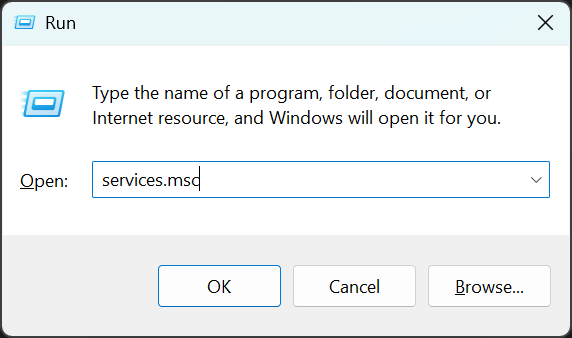
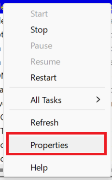
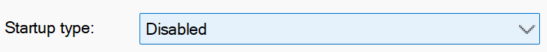

import { Steps } from '@astrojs/starlight/components';

:::note
Bu sorun, yalnızca sunucu yapılandırmasında özel bir tespit seçeneğini etkinleştiren belirli MTA sunucularında oluşur.
Bu tür yazılımlar tüm MTA sunucularında yasak **değildir**.

Gelecekte bu kategoriye giren benzer yazılımlar tespit edilirse, bu engelleme listesine eklenebilirler.
:::

Bu yazılımı çalıştırmanızı yasaklayan bir sunucudan 'NetLimiter' gerekçesiyle atıldınız.

Eğer Windows oturumunuzda daha sonra başka amaçlarla kullanmanız gerektiyse, artık hizmeti manuel olarak durdurabilir, Görev Yöneticisi'nden `NLsvc.exe` işlemini sonlandırabilir veya bilgisayarınızı yeniden başlatabilirsiniz.

Bu talimatları uygulamanın yanı sıra, eğer bu yazılımı kullanmak için meşru veya acil bir ihtiyacınız yoksa ve bu sunucunun düzenli bir ziyaretçisiyseniz, kendinizi bu zahmetten kurtarmak için yazılımı bilgisayarınızdan kaldırmanızı öneririz.
Lütfen çok az sayıda sunucunun bu tespiti etkinleştirdiğini ve bu durumdan etkilenen az sayıdaki kullanıcı grubundan biri olduğunuzu unutmayın. Bunu geçici bir çözüm olarak değerlendirebilirsiniz.
Bu sunucunun yöneticileri, NetLimiter'ın iyi niyetli kullanımları olabileceğini bilmekte ancak yazılımın oyunda gecikme (lag) yaratma amacıyla kullanılmasını engellemek istemektedir.

Daha detaylı bilgi için [MTA Anti-Cheat Kılavuzuna](https://wiki.multitheftauto.com/wiki/Anti-cheat_guide) (özellikle `SD #33` kısmına) göz atabilirsiniz.

### Çözüm

- MTA çalışırken veya bu yazılımı yasaklayan bir sunucuya bağlıyken NetLimiter istemcisini açmayın.
- Yazılımın arka plan hizmetinin (`NLsvc.exe`) otomatik olarak başlamasını engelleyin.

#### NetLimiter Hizmeti Nasıl Devre Dışı Bırakılır

<Steps>
    1. `Windows Tuşu` + `R` tuşlarına aynı anda basarak 'Çalıştır' penceresini açın.  
       Metin alanına `services.msc` yazın ve `Enter` tuşuna basın veya `Tamam` butonuna tıklayın.

        

    2. Yeni açılan 'Hizmetler' penceresinde:

        <Steps>
            1. 'NetLimiter' hizmetini bulun.
            2. Hizmetin üzerine sağ tıklayın.
            3. Hizmet özellikleri penceresini açmak için 'Özellikler' seçeneğine tıklayın.

                

            4. 'Başlangıç türü' seçeneğini **Devre Dışı** olarak değiştirin.

                

            5. Değişiklikleri uygulayın ve pencereyi kapatın.
        </Steps>

    3. Şimdi hizmeti durdurun veya bilgisayarınızı yeniden başlatın.

    4. NetLimiter'ı başlatmadan sunucuya tekrar bağlanmayı deneyin.
</Steps>
