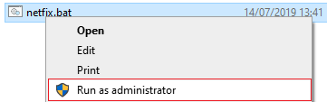

import { Steps } from '@astrojs/starlight/components';
import IconLinkCard from '../../../../../components/IconLinkCard.astro';

Eğer "bağlantı zaman aşımına uğradı/koptu" (connection timed out/lost), ağ sorunları, indirme hataları, `CD16` gibi hatalar veya diğer ağ bağlantısı sorunları yaşıyorsanız (örneğin sunucu listesinin hiç yüklenmemesi gibi), lütfen aşağıdaki çözüm yollarını deneyin.

### Çözüm 1: Netfix Kullanarak Ağ Arayüzlerini Sıfırlama

<Steps>
1. Yaygın ağ yapılandırmalarını sıfırlamak için `netfix.bat` betiğini indirin:

   <IconLinkCard
       icon="cloud-download"
       title="netfix.bat dosyasını indir"
       description="Ağ bağdaştırıcılarını otomatik olarak sıfırlayan ve DNS önbelleğini temizleyen toplu iş dosyası (1 KB)"
       href="/files/netfix.bat"
       target="_self" />

2. İndirilen dosyayı dosya gezgininde bulun, üzerine sağ tıklayın ve **"Yönetici olarak çalıştır"** seçeneğini seçin.

   

3. İşlem tamamlandıktan sonra **bilgisayarınızı yeniden başlatın** ve MTA'ya tekrar bağlanmayı deneyin.
</Steps>

---

### Çözüm 2: MTA'ya Güvenlik Duvarı ve Antivirüs Üzerinden İzin Verme
Eğer bu sorun birçok veya tüm sunucularda yaşanıyorsa, güvenlik yazılımınız MTA'nın veri trafiğini engelliyor olabilir.

* Hem `gta_sa.exe` hem de `Multi Theft Auto.exe` dosyalarının Windows Defender veya kullandığınız üçüncü taraf antivirüs/güvenlik duvarı yazılımlarının izin verilenler/beyaz listesinde olduğundan (hem **gelen** hem de **giden** trafik için) emin olun.

---

### Çözüm 3: Yönlendirici (Router) Güvenlik Duvarı Ayarlarını Kontrol Etme
Bazen modeminize veya yönlendiricinize ait katı güvenlik duvarı kuralları oyun paketlerini engelleyebilir veya düşürebilir.

<Steps>
1. Yönlendiricinizin (modeminizin) arayüz sayfasına giriş yapın.
   * Ağ geçidi adresinizi öğrenmek için Komut İstemi'ni (`cmd.exe`) açıp `ipconfig` yazın. "Default Gateway" (Varsayılan Geçit) IP adresine bakın (örn. `192.168.1.1` veya `192.168.0.1`).
   * Bu IP adresini tarayıcınızın (Chrome, Edge vb.) adres çubuğuna yazarak modem arayüzüne gidin.
2. Modem bilgilerinizi girerek giriş yapın.
   * Varsayılan giriş bilgileri genellikle modeminizin arkasındaki veya altındaki etikette yer alır veya modem modelinizi internette aratarak bulunabilir.
3. **Güvenlik Duvarı** (Firewall) veya **Güvenlik** (Security) sekmesini bulun ve bağlantı kopmalarını çözüp çözmediğini görmek için güvenlik duvarı seviyesini geçici olarak düşük (veya katı paket filtrelemeyi kapalı) duruma getirin.
   * Modem arayüzünüze erişim hakkında detaylı bir rehber için [MTA Forumundaki Port Yönlendirme Kılavuzu](https://forum.mtasa.com/topic/115141-guide-port-forwarding-in-order-to-run-a-mta-server/)'na göz atabilirsiniz (modem giriş bölümüne odaklanın).
</Steps>

---

### Çözüm 4: İnternet Servis Sağlayıcı (ISP) Sorunları
Bağlantı kopmaları tüm sunucularda yaşanıyorsa, İnternet Servis Sağlayıcınız oyun trafiği paketlerini engelliyor veya düşürüyor olabilir. 
* İnternet sağlayıcınızın destek hattı ile iletişime geçin ve durumu bildirin.
* Eğer sorun **yalnızca tek bir sunucuda** yaşanıyorsa, bu durum muhtemelen sunucu tarafındaki bir sorundan veya servis sağlayıcınız/ülkeniz ile o sunucu arasındaki bir yönlendirme probleminden kaynaklanıyordur. Yolu test etmek için Komut İstemi'ni (`cmd.exe`) açıp şu komutu çalıştırabilirsiniz:
  ```cmd
  tracert [SUNUCU_IP_ADRESI]
  ```
* Bu durumda sorunu ilgili sunucunun yönetimine bildirin.
