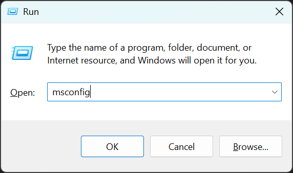
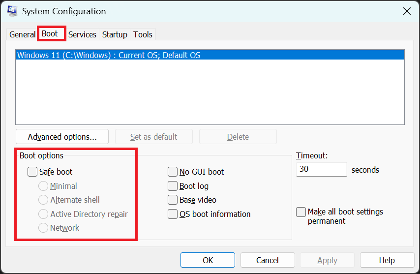

import { Steps } from '@astrojs/starlight/components';

<Steps>
    1. Normal modda başlatmak için bilgisayarınızı yeniden başlatın.

    2. Multi Theft Auto'yu tekrar çalıştırmayı deneyin.

    3. Bu işe yaramadıysa ve 'Güvenli Mod' hatası tekrar görünüyorsa,
       başlangıç modunu manuel olarak değiştirmeniz gerekir. Sonraki adımlar bunu nasıl yapacağınızı açıklar.

    4. `Windows Tuşu` + `R` tuşlarına aynı anda basarak 'Çalıştır' penceresini açın.  
       Metin alanına `msconfig` yazın ve `Enter` tuşuna basın veya `Tamam` butonuna tıklayın.

        

    5. Yeni açılan 'Sistem Yapılandırması' penceresinde, 'Önyükleme' (Boot) sekmesine geçin ve ardından Güvenli Önyükleme olmadan başlatmak istediğiniz işletim sistemi için **'Güvenli Önyükleme' (Safe Boot) seçeneğindeki işareti kaldırın**.

        

    6. Bu işlem sorunu çözmediyse, MTA destek ekibi ile iletişime geçin.  
       Bize ulaşmak için sayfanın altındaki bağlantıları kullanabilirsiniz.
</Steps>
